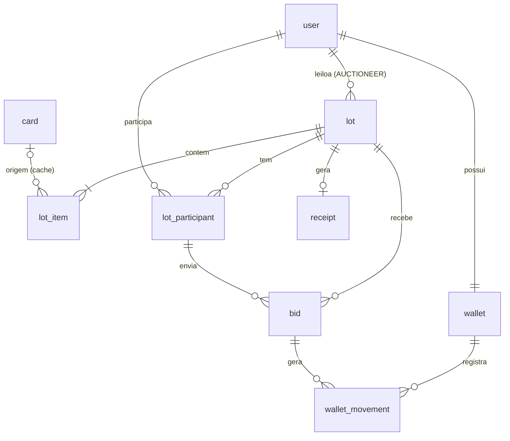

# Modelo de dados

Esquema em uso, alinhado a `src/db/schema.ts`. A versão anterior do modelo, em
que o lote era uma única carta e o status gravado misturava agendado com ao
vivo, não é mais a referência.

As regras de negócio estão em [Domínio](dominio.md). A construção do HMAC está
em [Validação por HMAC](validacao-hmac.md).

## Decisões

- Um lote tem N itens. Cancelar ou arrematar vale para o lote inteiro.
- Cada item guarda o snapshot da carta. A tabela `card` é cache de busca e não
  é a fonte de verdade de um lote publicado.
- O banco grava `ACTIVE`, `ENDED` e `CANCELED`. Agendado e ao vivo são
  calculados. Não há job só para virar essa chave.
- Dinheiro é `numeric(18,2)` em string. Cada lance, movimento, comprovante,
  lance inicial e incremento não passa de `1000000.00`. O saldo da carteira
  não tem esse teto; o maior valor da coluna é `9999999999999999.99`. Contas
  usam decimal no SQL ou em centavos inteiros, nunca float. A regra está em
  [Domínio](dominio.md#valores-monetários).
- Datas são `timestamptz` e saem em UTC.
- `bid` e `wallet_movement` não têm `updated_at`. A aplicação não os edita.
  Não há trigger de imutabilidade em `bid`.
- A integridade do histórico é HMAC-SHA256 encadeado, com âncora em
  `lot.bid_count` e `lot.head_hash`. A chave fica em `BID_HASH_SECRET`, fora
  do banco.
- `user`, `session`, `account` e `verification` seguem o Better Auth. O campo
  extra é `user.role`.

## Diagrama

## Invariantes

O detalhe de coluna está no schema. O que a aplicação e os `CHECK`s garantem:

**wallet.** Uma linha por usuário. `committed_balance >= 0` e
`committed_balance <= total_balance`. O disponível é
`total_balance - committed_balance`. A linha da carteira é o ponto de
`SELECT … FOR UPDATE` das operações de saldo.

**wallet_movement.** `amount > 0` e `amount <= 1000000.00`. `DEPOSIT` não tem
lote; os outros tipos exigem `lot_id`. `HOLD` e `RELEASE` exigem `bid_id`.
Um lance só reserva e só libera uma vez: único parcial em `(bid_id, type)`
para esses dois tipos. Um lote só liquida uma vez: único parcial em
`(lot_id, type)` para `SETTLEMENT_DEBIT` e `SETTLEMENT_CREDIT`.

**lot.** `opening_bid` e `min_increment` são positivos e não passam de
`1000000.00`. `starts_at < original_ends_at` e `ends_at >= original_ends_at`.
`CANCELED` exige `canceled_at` e `winner_id` nulo. `ENDED` exige `ended_at`.
`winner_id` preenchido exige `ENDED`. `current_bid_id` aponta o lance líder.
`settled_at` marca a liquidação concluída.

**lot_item.** Único em `(lot_id, position)`. `quantity > 0`. `card_name`,
`card_snapshot` e `image_path` são o congelamento da criação. `image_path` é
caminho local servido pela aplicação, no formato `/card-images/{id}.{ext}`.
Itens não são editados depois da publicação. A criação exige ao menos um item
na mesma transação. O mesmo `card_id` repetido no corpo vira um item por
ocorrência.

**card.** Chave é o passcode da YGOPRODeck. `raw` guarda a resposta original.
`image_path` pode ficar nulo até o download. Atualizar esta tabela não altera
itens já publicados.

**lot_participant.** Único em `(lot_id, user_id)` e em
`(lot_id, participant_no)`. O número é o apelido público daquele lote.

**bid.** Só lances aceitos. Único em `(lot_id, sequence)`, com sequência
`1, 2, 3…`. `amount` positivo e até `1000000.00`. `created_at` usa
`clock_timestamp()` e entra no anti-sniping e no HMAC. `previous_hash` do
primeiro lance é a gênese daquele lote.

**receipt.** Um por lote e um por lance vencedor. `final_amount` positivo e
até `1000000.00`. `winner_id` é consulta interna; o que a resposta pública
mostra é `winner_participant_no`. `share_token` é único e aleatório.

## Fluxos

### Lance aceito

Uma transação:

1. `SELECT … FROM lot WHERE id = ? FOR UPDATE`.
2. Conferir papel `BIDDER`, estado efetivo `LIVE`, que o usuário não é o líder
   e que o valor cobre o mínimo.
3. Travar as carteiras do novo líder e, se houver, do líder anterior, sempre
   em ordem de id. O PostgreSQL pode travar um `SELECT` ordenado antes do
   `ORDER BY`, então o código trava uma linha por vez.
4. Conferir `amount <= total - committed` do novo líder.
5. Obter ou criar o `lot_participant`, inserir o `bid` com
   `sequence = bid_count + 1` e o HMAC encadeado.
6. Gravar `HOLD` do novo líder e `RELEASE` do anterior, e atualizar as duas
   carteiras.
7. Atualizar `current_bid_id`, `bid_count`, `head_hash` e, na janela final,
   `ends_at` e `extension_count`.

O broadcast da sala acontece depois do commit. Sala vazia não dispara a
leitura pública.

### Liquidação

Na subida e a cada 10 segundos, lotes `ACTIVE` com `ends_at <= now` entram na
fila, ordenados por `ends_at` e `id`. Para cada um, numa transação:

1. Travar o lote e conferir de novo. Se não estiver ativo e vencido, sair.
2. Sem lances: marcar `ENDED`, `ended_at` e `settled_at`.
3. Com lances: travar as carteiras do vencedor e do leiloeiro, gravar
   `SETTLEMENT_DEBIT` e `SETTLEMENT_CREDIT`, criar o `receipt` e preencher
   `winner_id`, `ENDED`, `ended_at` e `settled_at`.

O `HOLD` do lance vencedor permanece no livro. O débito é que reduz total e
comprometido juntos. A liquidação só segue se esse `HOLD` ainda estiver aberto
na carteira do líder.

### Cancelamento

Na mesma transação: travar o lote, exigir dono, `ACTIVE` e término ainda no
futuro. Se houver líder, gravar `RELEASE` do lance atual e atualizar a
carteira. Marcar `CANCELED` e `canceled_at`. A condição do `UPDATE` exige
`ACTIVE`, então uma segunda chamada não reescreve o lote. O único
`(bid_id, type)` impede um segundo `RELEASE`.

## Integridade

Cada lance autentica o hash anterior, o lote, a sequência, o
`participant_no`, o valor e o instante, com serialização canônica. A gênese é
por lote. `head_hash` e `bid_count` são a âncora de fim e de contagem.

A auditoria devolve três resultados e nunca trata falha de verificação como
histórico íntegro: `INTACT`, `TAMPERED` e `VERIFICATION_FAILED`.

Quem altera só o banco é detectado ao mudar um lance, abrir um buraco na
sequência ou tirar o último registro sem acertar a âncora. Quem também tem
`BID_HASH_SECRET` consegue reescrever a cadeia. A âncora mora no mesmo banco:
restaurar um prefixo válido junto com `head_hash` e `bid_count` não exige a
chave. Esse limite está detalhado em
[Validação por HMAC](validacao-hmac.md).

## Índices que sustentam a consulta

- `lot (status, ends_at)` e `lot (status, starts_at)`, para o job e a vitrine.
- `lot (auctioneer_id)`, para o painel do dono.
- GIN `pg_trgm` em `lot.title` e `lot_item.card_name`, para a busca `ILIKE`.
- `lot_item (lot_id)` e `lot_item (card_id)`.
- `bid (lot_id, sequence)`, pelo único, e `bid (bidder_id)`.
- `lot_participant (user_id)`, para as participações.
- `wallet_movement (wallet_id, created_at)`, para o extrato.
